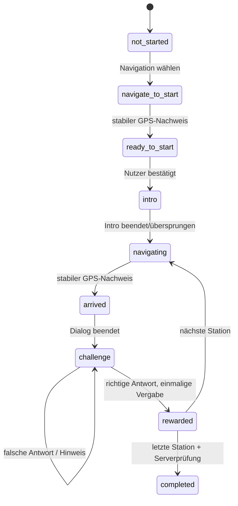

# Zielarchitektur

Dieses Dokument plant spätere Phasen; es autorisiert deren Implementierung nicht. Nach Phase 2 gilt der Design-Freigabestopp.

## Phase 2: drei Masken auf dem Bestand

Zentrale `src/theme/tokens.ts` mit gemeinsamem Farb-, Schrift-, Abstands- und Touchvertrag; helle Discovery- und immersive Adventure-Oberflächen sind Varianten derselben Marke. Wiederverwendbare Karten, Buttons, Fortschritt, Dialoggrundlage und Quest-Pin; keine Mockups als Vollbild-UI. Header-XP sind im Entwicklungsmodus ausdrücklich Vorschau, außerhalb ohne Backenddaten nicht als verdient ausgeben.

`Quest` bleibt Datenquelle der Darstellung. Alter, Strecke, Dauer und Sterne dürfen nur bestätigte Werte anzeigen; „offen“ ist ein legitimer Datenzustand. Details verlinken die vorhandene Navigation; diese hält Modus und Sensorzustand getrennt von Spielereignissen. Die Karte erhält ausschließlich freigegebene Ziele und Weggeometrie; Simulation bleibt im virtuellen Koordinatenraum und nie als echte Route sichtbar.

## Nach gesonderter Freigabe

| Modul                  | Verantwortung                                           | Unabhängiger Vertrag                                            |
| ---------------------- | ------------------------------------------------------- | --------------------------------------------------------------- |
| Auth                   | Identität, Session, Deep Links                          | Keine Quest- oder Rewardlogik                                   |
| ContentRepository      | veröffentlichte, unveränderliche Questversionen, Medien | Versions-ID bindet Run; validiertes Schema                      |
| QuestMachine           | Zustandsübergänge und Events                            | Reine Funktionen, stabile IDs, keine Sensor-/UI-Abhängigkeit    |
| NavigationService      | GPS, Heading, Zielpeilung, Ankunftskandidat             | Genauigkeits-/Alters-/Radiusprüfung; kein eigenmächtiger Reward |
| DialogueController     | Text, Sprecher, TTS/Audio, Skip/Replay                  | Ereignisse an CompanionRenderer, Stop bei Exit                  |
| CompanionRenderer      | Originalposen, später austauschbares Rig                | Stimmung und Sprechstatus als Eingabe, keine Antworten prüfen   |
| OfflineRepository/Sync | Snapshot, Assets, Outbox, Konflikte                     | Benutzerpartition und idempotente Operationen                   |
| RewardService          | servergeprüfte XP, Siegel, Badge                        | einmalige Grants/Ledger statt UI-Berechnung                     |
| Profile/Inventory      | Fortschritt und Belohnungen anzeigen                    | aus autorisierten Benutzerabfragen                              |

## Geplanter Zustandsautomat

`paused` speichert einen expliziten vorherigen Wiedereinstiegspunkt; `resume` stellt ihn wieder her. Das ist ein Ausbau gegenüber dem jetzigen Erhalten des Runs beim Verlassen. Ein einmal freigeschalteter Ort bleibt zugänglich. Vordergrundfokus steuert Sensoren; keine permanente Hintergrundortung.

## Geplanter Datenfluss

Öffentlicher Content → Repository → versionierter Offlinecache → UI. Benutzeraktion → reine Zustandsprüfung → lokal gespeicherte Operation mit UUID → RPC → transaktionale Prüfung/Receipt → bestätigter Snapshot. Wiederholung derselben UUID liefert denselben Abschluss, kein neues Abzeichen. Ausstehende Offline-Antworten sind vorläufig; endgültige Belohnungen erst nach Serverbestätigung. Übung bleibt eine getrennte Partition und kann kein reguläres Badge erzeugen.

Das bestehende Schema wird angepasst statt parallel neu angelegt: `quests/quest_versions` entsprechen Missionsversionen, `quest_runs` dem Run, `private.solutions` den geschützten Challenge-Secrets. Ein XP-Ledger und ein echtes Inventarmodell sind noch zu ergänzen. Neue Serververträge benötigen Migration, RLS-/Idempotenztests und gesonderte Freigabe.
